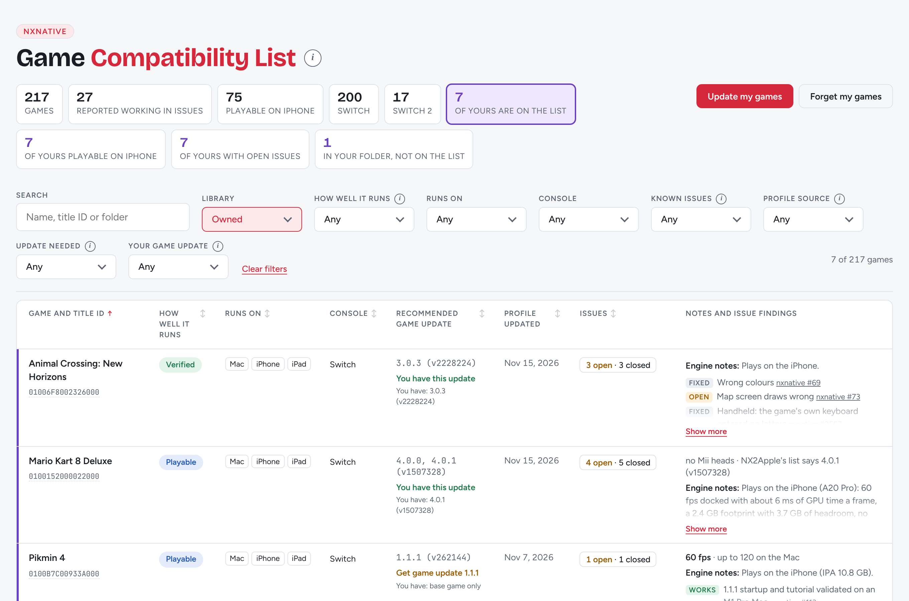

# NXNative Game Compatibility List

A filterable list of every Nintendo Switch and Switch 2 game the [nxnative](https://github.com/seedds/nxnative) engine has a profile for, plus games people report in its issues. For each game it shows:

- how well it runs, and where (Mac, iPhone, iPad)
- the update the profile expects
- known issues, with links to the GitHub issues that report them

**Check your own games:** choose the folder that holds your games, and the list shows which ones you have and whether your update matches the recommended one.

**Open it:** https://heyflorin.github.io/nx-game-list/

<picture>
  <source media="(prefers-color-scheme: dark)" srcset="docs/screenshot-dark.png">
  
</picture>

<sub>Shown with a sample games folder. The page reads only file and folder names, in your browser.</sub>

## Use it

Open the page (GitHub Pages, or `index.html` in any browser), press **Check my games**, and choose your games folder.

- **What it reads:** only file and folder names, inside your browser. No game file is opened and nothing is uploaded. Your browser may still word its prompt as "upload"; that is the browser's wording for giving a page access to a folder.
- **Privacy:** **Check my games** opens a short dialog that spells this out before you choose anything: what the page reads, what it never reads or sends, and what it keeps.
- **Progress:** in Chrome and Edge on a computer, the page reads the folder itself and shows each folder as it goes, with a running count of files and game files. Other browsers hand over the whole list at once, so they show "Loading your games…" until it arrives; a large folder can take a minute. (Inside a frame, as in a claude.ai preview, Chrome also uses the second way.)
- **Where it's kept:** the result is stored in your browser's local storage, so it is there the next time you open the page on the same browser. **Forget my games** removes it.
- **Without folder picking** (some phones and tablets): use **Choose files instead** in the same dialog and select the game files themselves.

### How your games are recognized

- **Game files:** `.nsp`, `.nsz`, `.xci`, `.xcz` and `.nup` files, and Switch 2 dump folders (`<game>/base/exefs/…`, with updates in `<game>/updates/<version>/`). The folder can be laid out any way: one folder per game, all files in one folder, or groups of folders.
- **Title IDs first:** a title ID in a file or folder name, such as `[0100000000010000]`. The ID of an update (`…800`) or a DLC (`…1xxx`) leads to its base game.
- **Names second:** if there is no ID, the file name and then its folders are compared with the list's game names. Common short names (for example "TOTK") are in `ALIASES` in `tools/curation.py`.
- **Versions:** each file is sorted into base game, update or DLC, by its title ID (an update ends in `800`, a DLC in anything other than `000`) or by words like "Update" or "DLC" in its name. Only base game and update files count toward your version; a DLC's own version never does. Versions are read from names such as `[v393216]`, `[1.2.1]`, `Update 1.1.0` or `ACNH_3.0.3.nsp`, and from a dump's `updates/<version>` folder. A file with no title ID or recognizable name belongs to the game whose other files share its folder. Your copy matches when any version found is the recommended one, in either form.
- **What was read:** hovering a game's title ID shows whether it was found in your folder, where, and each file that was read, with its kind and version. Your games are also highlighted in purple.
- **Games with no profile** are listed under "In your folder, not on the list".

## Where the data comes from

- **nxnative profiles:** [dm/games](https://github.com/seedds/nxnative/tree/main/dm/games), its index and each game's notes. The recommended update is the build the profile registers, "Profile updated" is the date of the profile's last commit, and the ratings use the notes' own wording.
- **NX2Apple's list:** [GAMES.md](https://github.com/LNPANDY/NX2Apple/blob/main/GAMES.md), for iPhone runs its maintainers verified, and gallery notes.
- **Issues:** every open and closed issue in [seedds/nxnative](https://github.com/seedds/nxnative/issues?q=is%3Aissue) and [LNPANDY/NX2Apple](https://github.com/LNPANDY/NX2Apple/issues?q=is%3Aissue). Only titles and descriptions are read, not comment threads.

Ratings that come from the notes are matched by their wording, so a few may be off: each row shows the "Engine notes" sentence it is based on.

## Refresh the data

**Automatically:** the workflow in `.github/workflows/refresh.yml` runs `refresh.sh` every hour, at 17 minutes past. It commits only when the games data changed, and that push redeploys GitHub Pages. To run it now, open the **Actions** tab, choose **Refresh the list**, then **Run workflow**. It needs no setup: it uses the repository's own Actions token.

What it updates on its own:
- nxnative's profiles: new games, ratings from their notes, recommended updates, and profile dates
- NX2Apple's list
- every game's issue list, with findings marked fixed when their issue closes

The short hand-written summaries in `tools/curation.py` stay as they are until someone edits them.

**By hand:**

```bash
./refresh.sh
```

It re-downloads the sources into `data/` and rebuilds `index.html`. It needs `curl`, `git`, `python3`, and the [GitHub CLI](https://cli.github.com/) (`gh`), signed in, for the issue search.

## Edit

- **`tools/curation.py`:**
  - Hand-written summaries of issues (`REPORTS`), and games known only from issues (`EXTRA_GAMES`). A finding whose issue has closed is marked fixed or closed automatically.
  - Name aliases (`ALIASES`), and notes shown beside games that have no profile (`MISSING_NOTES`).
- **`tools/template.html`:** the page, including the folder matching.
- **`tools/enrich.py`:** builds the data the page shows.

## Publish on GitHub Pages

In the repository's **Settings → Pages**, choose **Deploy from a branch**, branch `main`, folder `/ (root)`. The page is `index.html`; `.nojekyll` makes Pages serve the files as they are.
